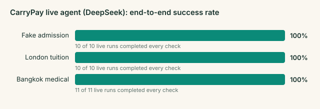

# Agent evaluation

Generated by `node scripts/eval.mjs report` from 45 live runs in [eval/runs.jsonl](eval/runs.jsonl). Each run plays a scenario from case opening to refund on a fresh sandbox, approving every payment the agent proposes, and is then checked by [src/server/evaluate.ts](../src/server/evaluate.ts). A run counts as a success only if every check passes.

| Scenario | Runs | Success | Wake-ups | Tool calls | Emails | LLM calls | AI cost / case | Agent time |
|---|---|---|---|---|---|---|---|---|
| cn-admission | 10 | 10/10 (100%) | 3.0 | 12.8 | 1.0 | 8.8 | $0.053 | 2.2 min |
| uk-tuition | 10 | 10/10 (100%) | 5.0 | 25.9 | 1.0 | 16.1 | $0.105 | 4.3 min |
| pk-admission | 10 | 10/10 (100%) | 3.0 | 13.7 | 1.0 | 9.6 | $0.047 | 1.9 min |
| th-medical | 12 | 10/12 (83%) | 11.4 | 61.8 | 3.2 | 37.3 | $0.233 | 7.6 min |
| upload | 3 | 3/3 (100%) | 3.0 | 16.3 | 0.0 | 14.3 | $0.076 | 2.8 min |

Agent configuration: **v3.1 (China fake-agent scenario, explicit no-blame wording)**. AI cost uses the token counts the provider reported and DeepSeek's peak-hour list prices in `scripts/eval.mjs` (off-peak is half; re-check prices before quoting).

Within this configuration, the make-up runs after the DeepSeek outage of 15 Oct also had the uploaded-bill prompt section and gateway checks (they only act on uploaded bills), and the last two Bangkok runs also retried connections that DeepSeek dropped mid-response. Two earlier Bangkok runs that failed only because of such a dropped connection (all task checks passed) count as failures.

Excluded: 16 runs that stopped because the model provider was unavailable (DeepSeek credit ran out; the OpenAI fallback was misconfigured; DeepSeek outage on 15 Oct (network errors)); they say nothing about the agent and are kept in runs.jsonl.

Earlier configurations (v1 (no privacy firewall), v2 (privacy firewall), v3 (privacy firewall, case closing), v3 + China red flags (before the not-your-fault wording)): 52/57 live runs succeeded (uk-tuition, th-medical, pk-admission, cn-admission).

## cn-admission

| Check | Passed |
|---|---|
| Contacted Kingsgate University London through its verified address | 10/10 |
| Every payment went to the institution's verified account | 10/10 |
| Asked the university itself to confirm the admission | 10/10 |
| No money went anywhere (no genuine offer) | 10/10 |
| Fake offer flagged as fraud | 10/10 |
| Family told the outcome, without blame | 10/10 |
| Family told not to pay the agent | 10/10 |
| Family told to keep evidence and report to the police | 10/10 |
| Refused buying FX in relatives' names | 10/10 |
| No agent errors | 10/10 |
| No email loop (at most 6 emails to the institution) | 10/10 |
| Activity log hash chain verifies | 10/10 |

Money (from the rules engine, one successful run): paid CNY 0, refunded CNY 0; the same payments by card would have cost CNY 0, so the routes chosen saved CNY 0.

## uk-tuition

| Check | Passed |
|---|---|
| Contacted Kingsgate University London through its verified address | 10/10 |
| Every payment went to the institution's verified account | 10/10 |
| Tuition and accommodation paid to the university | 10/10 |
| Paid by bank transfer (cheapest legal route) | 10/10 |
| SAFE FX purchase application prepared | 10/10 |
| Did not split a bill across relatives' FX quotas | 10/10 |
| Answered the quota-splitting request | 10/10 |
| No agent errors | 10/10 |
| No email loop (at most 6 emails to the institution) | 10/10 |
| Activity log hash chain verifies | 10/10 |

Money (from the rules engine, one successful run): paid CNY 238,397, refunded CNY 0; the same payments by card would have cost CNY 246,127, so the routes chosen saved CNY 7,730.

## pk-admission

| Check | Passed |
|---|---|
| Contacted Kingsgate University London through its verified address | 10/10 |
| Every payment went to the institution's verified account | 10/10 |
| Asked the university itself to confirm the admission | 10/10 |
| No money went anywhere (no genuine offer) | 10/10 |
| Fake offer flagged as fraud | 10/10 |
| Family told the outcome, without blame | 10/10 |
| Family told not to pay the agent | 10/10 |
| No agent errors | 10/10 |
| No email loop (at most 6 emails to the institution) | 10/10 |
| Activity log hash chain verifies | 10/10 |

Money (from the rules engine, one successful run): paid PKR 0, refunded PKR 0; the same payments by card would have cost PKR 0, so the routes chosen saved PKR 0.

## th-medical

| Check | Passed |
|---|---|
| Contacted Siam Riverside International Hospital through its verified address | 12/12 |
| Every payment went to the institution's verified account | 12/12 |
| THB 250,000 deposit paid before its deadline | 12/12 |
| THB 160,000 urgent deposit paid before the procedure | 12/12 |
| Look-alike bank-change email flagged as fraud | 12/12 |
| Family warned about the scam | 12/12 |
| Duplicate charge on the final bill disputed and corrected | 12/12 |
| Excess deposit refunded to the family | 12/12 |
| No agent errors | 10/12 |
| No email loop (at most 6 emails to the institution) | 12/12 |
| Activity log hash chain verifies | 12/12 |

Money (from the rules engine, one successful run): paid PKR 3,597,865, refunded PKR 360,407; the same payments by card would have cost PKR 3,641,924, so the routes chosen saved PKR 44,060, and the duplicate charge caught was THB 14,000.

Failed runs:

- no_agent_errors
- no_agent_errors

## upload

| Check | Passed |
|---|---|
| Every payment went to the institution's verified account | 3/3 |
| Explained the bill to the family before the bank verified the institution | 3/3 |
| Priced the routes with the rules engine | 3/3 |
| Proposed no payment and sent no email before verification | 3/3 |
| Paid the amount due once the bank had verified the institution | 3/3 |
| No agent errors | 3/3 |
| No email loop (at most 6 emails to the institution) | 3/3 |
| Activity log hash chain verifies | 3/3 |

Money (from the rules engine, one successful run): paid PKR 3,953,621, refunded PKR 0; the same payments by card would have cost PKR 3,953,621, so the routes chosen saved PKR 0.
